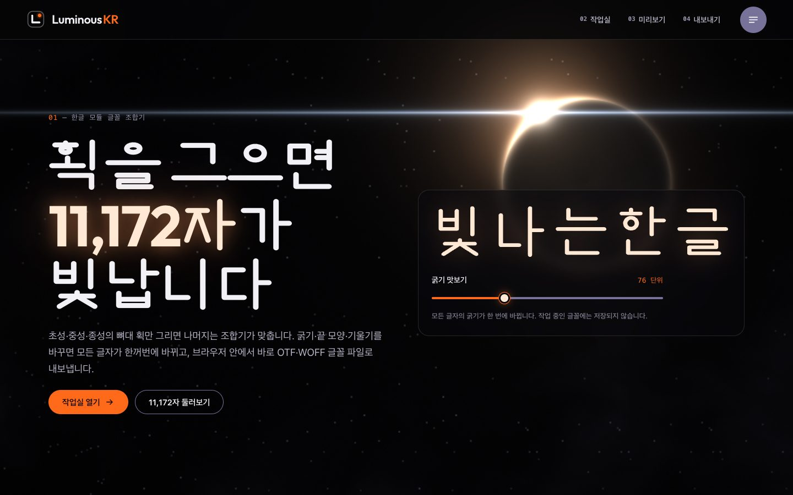
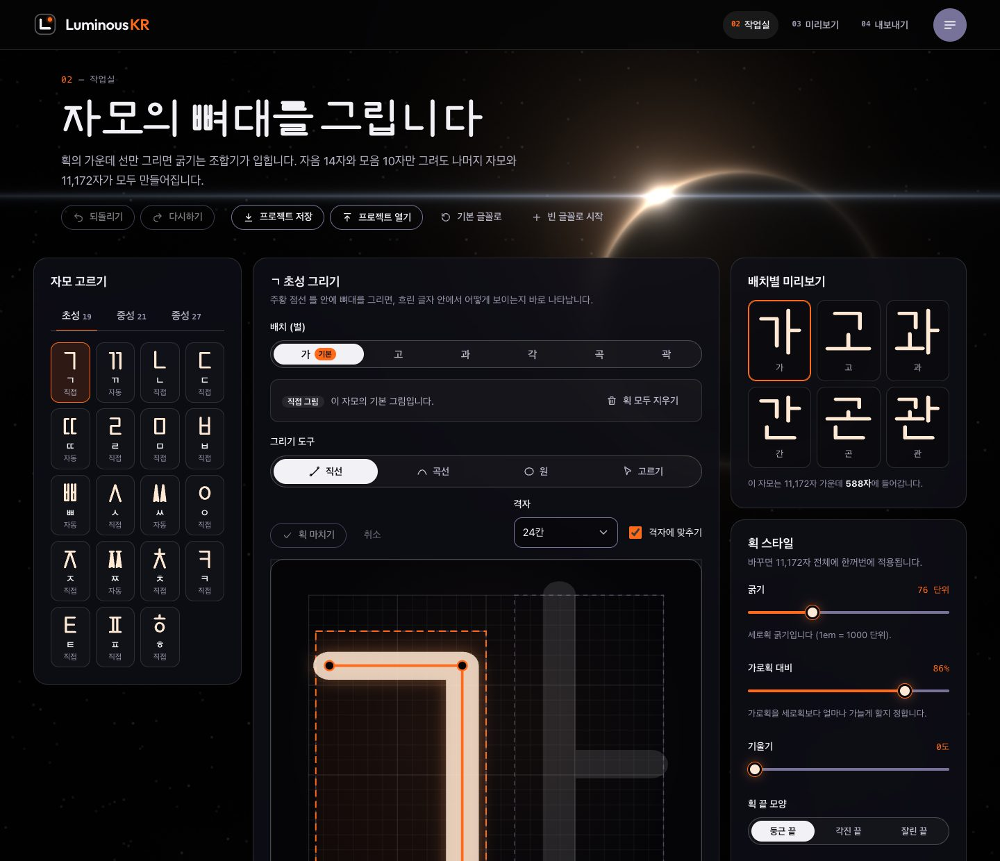
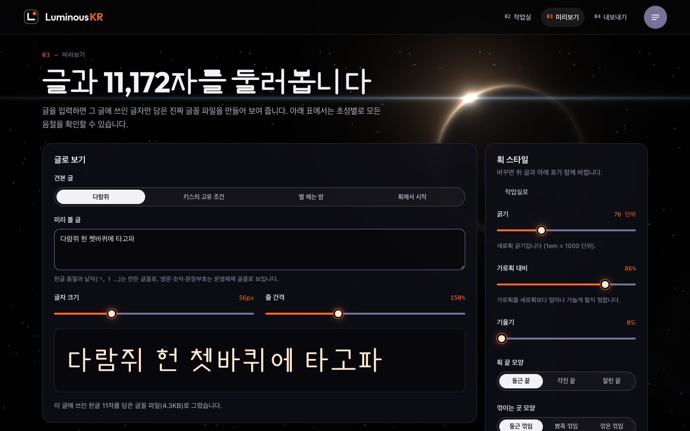
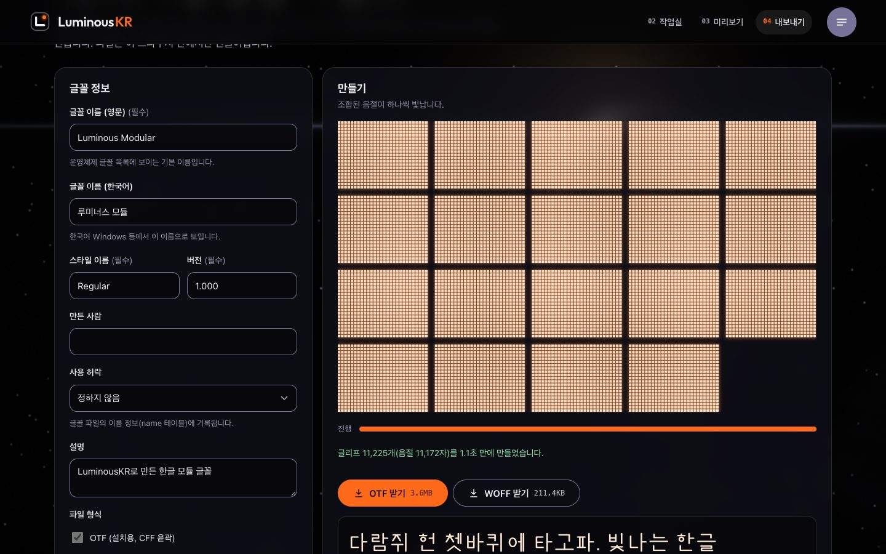
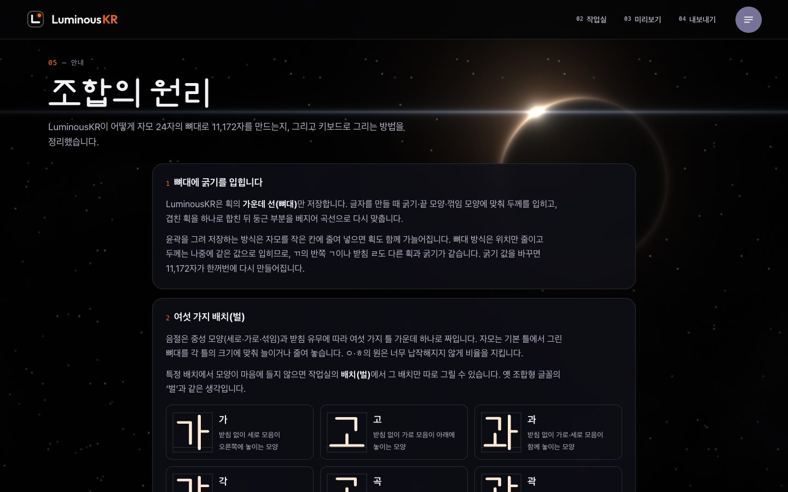
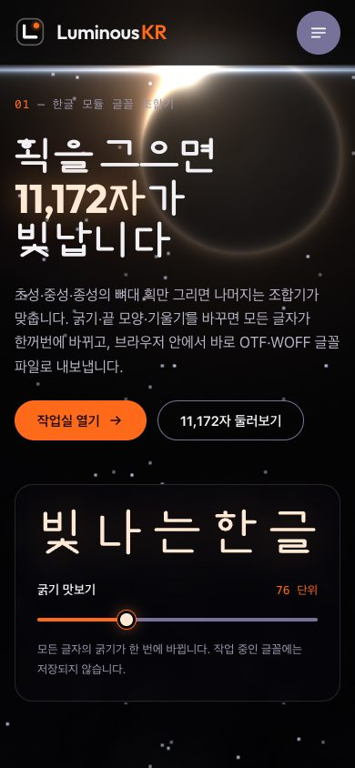
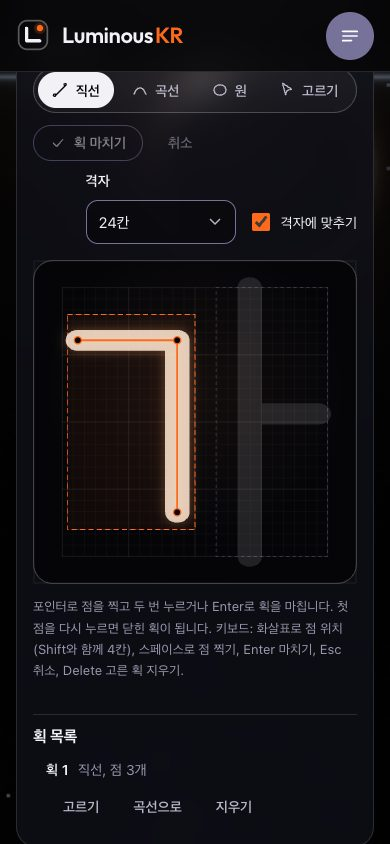

# LuminousKR - 한글 모듈 글꼴 조합기

[](https://github.com/ryushin01/LuminousKR/actions/workflows/ci.yml)


초·중·종성 획의 뼈대만 그리면 한글 11,172자를 조합해 OTF·WOFF 글꼴 파일로 내보내는 웹 도구입니다. 자모 24자만 그려도 겹자음·겹받침·섞임 모음과 모든 음절이 만들어지고, 굵기를 바꾸면 11,172자가 한꺼번에 바뀝니다.

**[바로 써 보기](https://ryushin01.github.io/LuminousKR/)** · [Storybook](https://ryushin01.github.io/LuminousKR/storybook/)

> **프로젝트 상태:** 개인 **포트폴리오 프로젝트**입니다. 서버 없이 브라우저 안에서만 동작하며, 그린 획과 만든 글꼴 파일은 어디에도 보내지 않습니다. 화면의 한글 제목은 이 조합기가 기본 프리셋으로 만든 글꼴로 그렸습니다.

## 화면

| 홈                                                                                                                 | 작업실                                                                                                           |
| ------------------------------------------------------------------------------------------------------------------ | ---------------------------------------------------------------------------------------------------------------- |
|  |  |

| 미리보기                                                                               | 내보내기                                                                                            |
| -------------------------------------------------------------------------------------- | --------------------------------------------------------------------------------------------------- |
|  |  |

| 안내                                                                 | 모바일 홈                                                                                  | 모바일 작업실                                                                     |
| -------------------------------------------------------------------- | ------------------------------------------------------------------------------------------ | --------------------------------------------------------------------------------- |
|  |  |  |

## 주요 기능

| 화면     | 내용                                                                                                                 |
| -------- | -------------------------------------------------------------------------------------------------------------------- |
| 작업실   | 직선·곡선·원 도구, 격자 맞춤(12·24·48칸), 꼭짓점 끌기, 키보드만으로 그리기, 획 목록, 되돌리기·다시하기               |
| 작업실   | 배치(벌)별 따로 그리기, 자동으로 만든 자모(ㄲ·ㅘ·ㄺ 등) 가져와 고치기, 굵기·가로획 대비·끝 모양·꺾임·기울기·글자 틀  |
| 미리보기 | 입력한 글자만 담은 실제 글꼴 파일(FontFace)로 글 그리기, 초성별 588자 표로 11,172자 확인                             |
| 내보내기 | 영문·한국어 글꼴 이름, 사용 허락, OTF(CFF)·WOFF 만들기, 11,172칸이 차례로 빛나는 진행 그림, 만든 글꼴로 바로 써 보기 |
| 공통     | 브라우저 자동 저장, 프로젝트 파일(.json) 저장·열기, WebGL 우주 배경과 움직임 멈춤, 번호 붙은 전체 메뉴               |

조합 엔진은 뼈대에 두께를 입혀(Clipper2) 겹친 획을 합치고, 둥근 부분을 베지어 곡선으로 다시 맞춘 뒤 opentype.js로 파일을 씁니다. 모든 계산은 Web Worker에서 돌아 화면이 멈추지 않습니다(11,225글리프 약 1.2초).

## 기술 스택


| 구분        | 사용 기술                                                                                                                                                                                  |
| ----------- | ------------------------------------------------------------------------------------------------------------------------------------------------------------------------------------------ |
| 프레임워크  | SolidJS 1.9, @solidjs/router, TypeScript, Vite 8                                                                                                                                           |
| 글꼴·그래픽 | opentype.js 2, Clipper2(clipper2-ts), Web Worker, CompressionStream(WOFF), FontFace API, WebGL2(GLSL), SVG                                                                                 |
| 스타일      | CSS Modules, CSS 변수 토큰, Outfit(영문 제목)                                                                                                                                              |
| 품질        | ESLint(eslint-plugin-solid, jsx-a11y), Prettier, Steiger(FSD), Vitest + Solid Testing Library, Playwright E2E(axe 접근성, 화면 폭별 넘침, 키보드 그리기, 파일 검증, Storybook 스토리 검사) |
| 문서        | Storybook 10 (storybook-solidjs-vite, addon-a11y)                                                                                                                                          |
| 배포        | GitHub Pages, GitHub Actions                                                                                                                                                               |

## 시작하기

Node.js 26(`.nvmrc`)과 pnpm 12가 필요합니다.

```bash
nvm use
corepack enable pnpm
pnpm install
pnpm dev    # http://localhost:5173
```

| 명령                                   | 설명                                                   |
| -------------------------------------- | ------------------------------------------------------ |
| `pnpm build` / `build:all`             | 프로덕션 빌드 / Storybook까지 함께 빌드                |
| `pnpm storybook`                       | Storybook 개발 서버 (`http://localhost:6006`)          |
| `pnpm lint` / `lint:fsd` / `typecheck` | ESLint / FSD 구조 검사 / 타입 검사                     |
| `pnpm test`                            | 엔진·화면 단위 테스트                                  |
| `pnpm test:e2e`                        | 프로덕션 빌드의 실제 화면 검사 (먼저 `build:all` 필요) |
| `pnpm fonts:display`                   | 제목용 글꼴(Luminous Display)을 조합기로 다시 만들기   |

전체 명령과 규칙은 [개발 가이드](docs/development.md)를 참고하세요.

## 프로젝트 구조

[Feature-Sliced Design](https://feature-sliced.design) 계층으로 나눕니다.

```
src/
├─ app/        진입점, 라우터, 공통 레이아웃, 전역 스타일·제목 글꼴
├─ pages/      홈, 작업실(그리기 판·편집기), 미리보기, 내보내기, 안내
├─ widgets/    머리글·전체 메뉴, WebGL 우주 배경
├─ features/   획 스타일 조절, 프로젝트 저장·열기
├─ entities/
│  └─ font/    자모 모델·배치·파생 규칙, 조합 엔진, 조합 워커, 글리프 표시
└─ shared/     한글 표, 기하·곡선 맞춤, OTF·WOFF 쓰기, 워커 RPC, 공용 UI
```

## 문서

| 문서                               | 내용                                                                   |
| ---------------------------------- | ---------------------------------------------------------------------- |
| [조합 원리](docs/engine.md)        | 뼈대 모델, 여섯 배치, 파생 규칙, 굵기 입히기·곡선 맞춤, 글꼴 파일 구성 |
| [개발 가이드](docs/development.md) | 구조, 명령, 테스트, 제목 글꼴, 접근성 점검                             |
| [CI · 배포](docs/deployment.md)    | GitHub Actions, GitHub Pages, 화면별 HTML                              |
| [버전 기록](CHANGELOG.md)          | 버전별 변경 내용                                                       |
